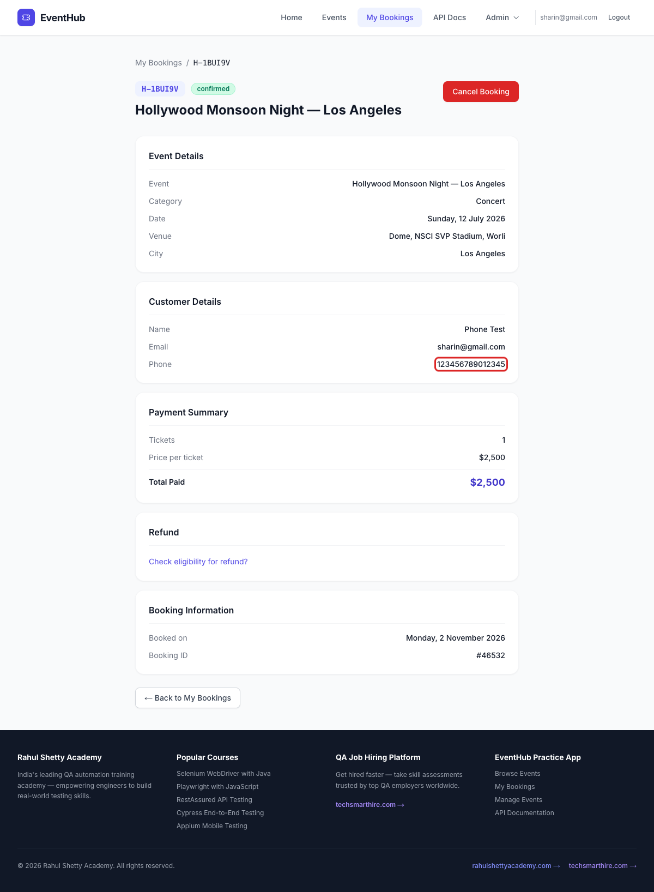
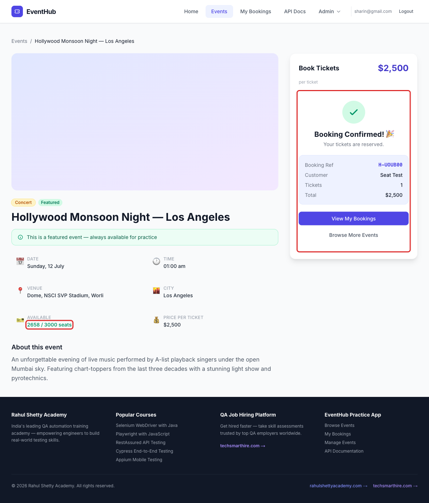
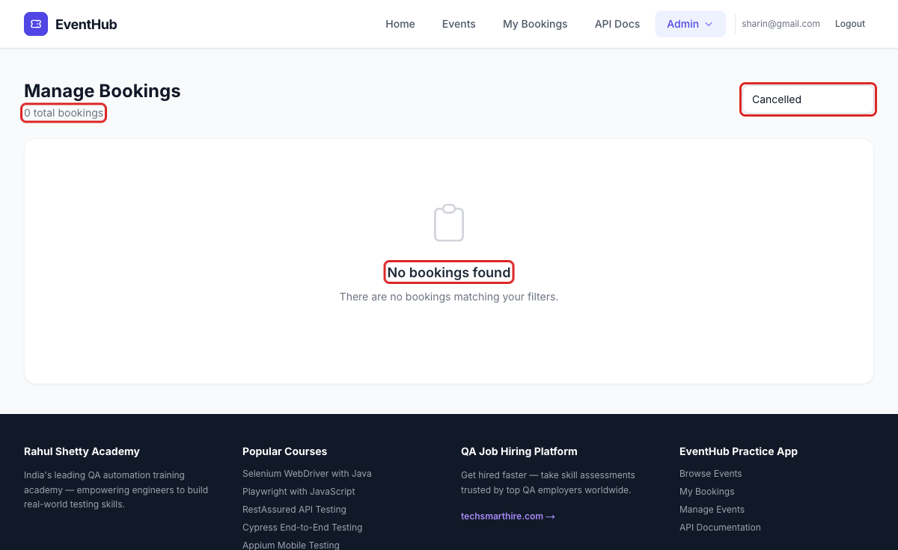

# Bug Reports – EventHub

## BUG-001: Past events are listed under "Upcoming Events"

All 3 events on the Events page have already taken place (18 Apr, 12 Jul and 20 Oct 2026), but they are still shown under the "Upcoming Events" heading. The dates also don't show the year, so there is no way to tell from the page that these events are over.

**Severity:** Medium · **Priority:** Medium

**Preconditions:** User is logged in to EventHub.

**Steps to Reproduce:**

1. Go to Events.
2. Look at the heading and the date on each event card.
3. Click Book Now on Dilli Diwali Mela and look at the date on the details page.

**Expected Result:** Only events that haven't happened yet are listed under "Upcoming Events", and dates show the year.

**Actual Result:** All 3 past events are listed under "Upcoming Events", and the dates show no year ("Tue, 20 Oct", "Sun, 12 Jul", "Sat, 18 Apr").

---

## BUG-002: Hollywood Monsoon Night has mixed-up location and can't be found with the City filter

The event title and city say Los Angeles, but the venue is NSCI SVP Stadium, Worli, which is in Mumbai, and the description says "under the open Mumbai sky". Los Angeles is not an option in the City filter, and filtering by Mumbai shows no events, so this event can't be found with the filter at all.

**Severity:** Medium · **Priority:** Medium

**Preconditions:** User is logged in to EventHub.

**Steps to Reproduce:**

1. Go to Events.
2. Open Hollywood Monsoon Night — Los Angeles and look at the title, venue, city and description.
3. Go back to Events and open the City filter.
4. Select Mumbai.
5. Open `/events?city=Los Angeles` in the address bar.

**Expected Result:** The title, venue, city and description all point to the same city, and that city can be selected in the City filter.

**Actual Result:** The title and city say Los Angeles, while the venue (Worli) and description say Mumbai. Los Angeles is missing from the City filter, and selecting Mumbai shows "No events found". Opening `/events?city=Los Angeles` does show the event, but the City filter still says "All Cities".

---

## BUG-003: Booking form accepts phone numbers longer than 10 digits

The booking form says "Enter a valid 10-digit phone", but it accepts phone numbers with more than 10 digits. Bookings with an 11-digit and a 15-digit phone number were both confirmed, and the full number is saved on the booking.

**Severity:** Medium · **Priority:** Medium

**Preconditions:** User is logged in to EventHub.

**Steps to Reproduce:**

1. Go to Events and click Book Now on Hollywood Monsoon Night — Los Angeles.
2. Enter Full Name "Phone Test", a valid email and Phone Number "123456789012345" (15 digits).
3. Click Confirm Booking.
4. Click View My Bookings and open View Details on the new booking.

**Expected Result:** The error "Enter a valid 10-digit phone" is shown and the booking is not created.

**Actual Result:** No error is shown, the booking is confirmed, and the booking details show the phone as "123456789012345".

---

## BUG-004: Available seats don't update after booking

After a booking is confirmed, the "Available" seat count on the event page stays the same. The correct, lower number only shows after the page is reloaded.

**Severity:** Low · **Priority:** Low

**Preconditions:** User is logged in to EventHub.

**Steps to Reproduce:**

1. Go to Events and click Book Now on Hollywood Monsoon Night — Los Angeles.
2. Note the Available seats (for example "2658 / 3000 seats").
3. Book 1 ticket with valid details and click Confirm Booking.
4. Look at the Available seats again.
5. Reload the page.

**Expected Result:** After the booking is confirmed, Available shows one seat less ("2657 / 3000 seats").

**Actual Result:** Available still shows "2658 / 3000 seats" after the booking is confirmed. It only changes to "2657 / 3000 seats" after reloading the page.

---

## BUG-005: Cancelled bookings disappear instead of showing in the "Cancelled" filter

Manage Bookings has a status filter with "Cancelled", but cancelled bookings are removed from the list completely instead of getting the status "cancelled". Because of this, the Cancelled filter always shows "No bookings found".

**Severity:** Medium · **Priority:** Medium

**Preconditions:** User is logged in to EventHub and has at least one confirmed booking.

**Steps to Reproduce:**

1. Book 1 ticket for Dilli Diwali Mela.
2. Go to Admin > Manage Bookings and find the new booking (status "confirmed").
3. Click Cancel on the booking and then click "Yes, cancel it".
4. Select "Cancelled" in the status filter.

**Expected Result:** The cancelled booking stays in the list with status "cancelled" and is shown when the "Cancelled" filter is selected.

**Actual Result:** The booking disappears from the list (total bookings go from 9 to 8), and the "Cancelled" filter shows "0 total bookings" and "No bookings found".

