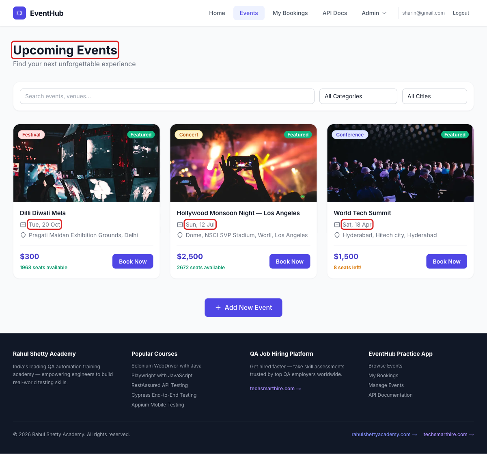
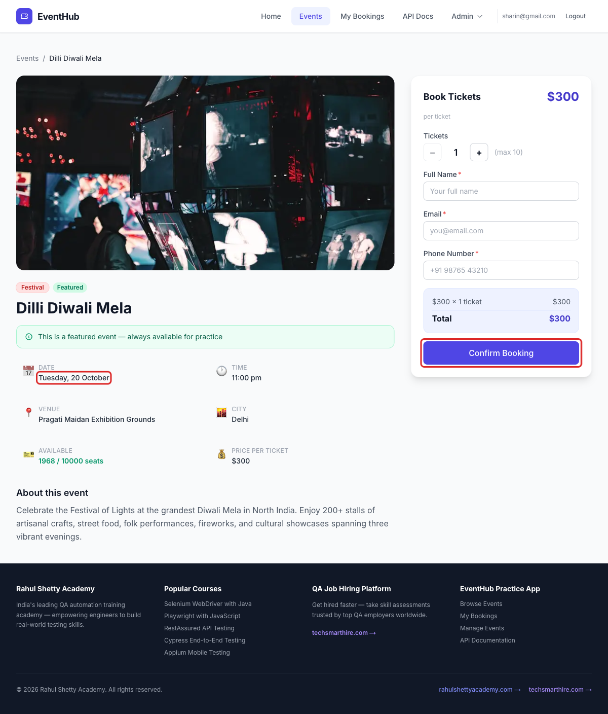
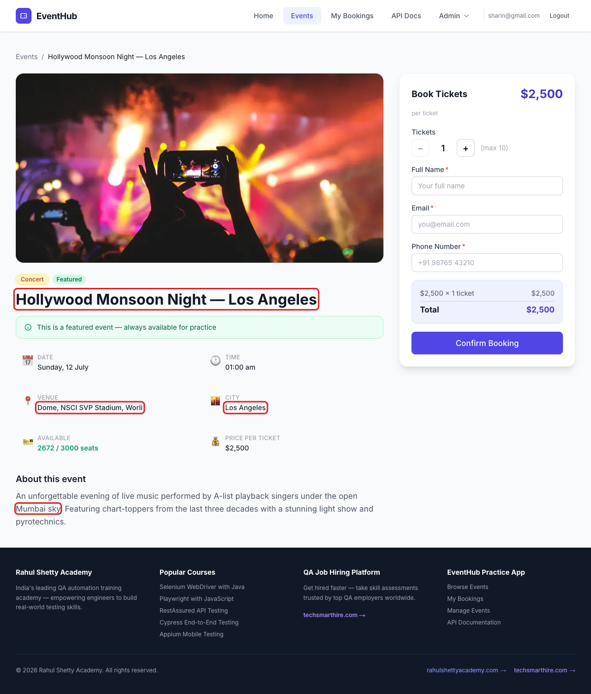

# Bug Reports – EventHub

## BUG-001: Past events are listed under "Upcoming Events"

All 3 events on the Events page have already taken place (18 Apr, 12 Jul and 20 Oct 2026), but they are still shown under the "Upcoming Events" heading. The dates also don't show the year, so there is no way to tell from the page that these events are over.

**Severity:** Medium · **Priority:** Medium

**Preconditions:** User is logged in to EventHub.

**Steps to Reproduce:**

1. Go to Events.
2. Look at the heading and the date on each event card.
3. Click Book Now on Dilli Diwali Mela and look at the date on the details page.

**Expected Result:** Only events that haven't happened yet are listed under "Upcoming Events", and dates show the year.

**Actual Result:** All 3 past events are listed under "Upcoming Events", and the dates show no year ("Tue, 20 Oct", "Sun, 12 Jul", "Sat, 18 Apr").

---

## BUG-002: Hollywood Monsoon Night has mixed-up location and can't be found with the City filter

The event title and city say Los Angeles, but the venue is NSCI SVP Stadium, Worli, which is in Mumbai, and the description says "under the open Mumbai sky". Los Angeles is not an option in the City filter, and filtering by Mumbai shows no events, so this event can't be found with the filter at all.

**Severity:** Medium · **Priority:** Medium

**Preconditions:** User is logged in to EventHub.

**Steps to Reproduce:**

1. Go to Events.
2. Open Hollywood Monsoon Night — Los Angeles and look at the title, venue, city and description.
3. Go back to Events and open the City filter.
4. Select Mumbai.
5. Open `/events?city=Los Angeles` in the address bar.

**Expected Result:** The title, venue, city and description all point to the same city, and that city can be selected in the City filter.

**Actual Result:** The title and city say Los Angeles, while the venue (Worli) and description say Mumbai. Los Angeles is missing from the City filter, and selecting Mumbai shows "No events found". Opening `/events?city=Los Angeles` does show the event, but the City filter still says "All Cities".

