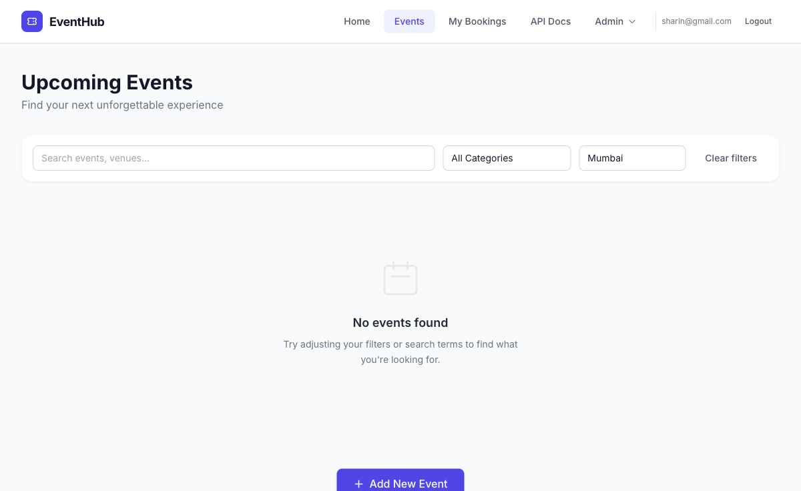
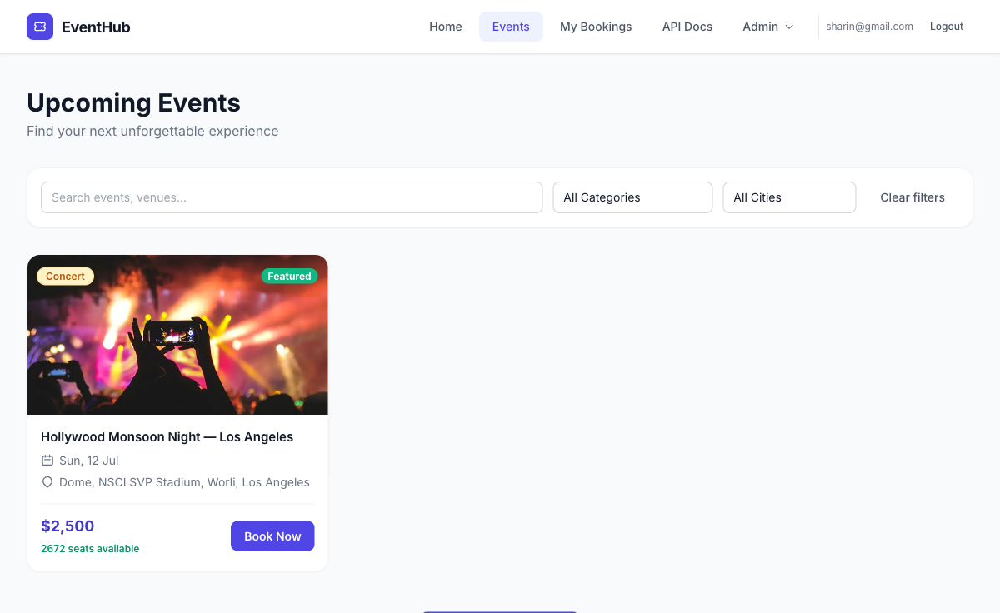

# Bug Reports – EventHub

Defects found while testing [EventHub](https://eventhub.rahulshettyacademy.com) during exploratory testing and automation work.
Each bug is also tracked as a GitHub Issue in this repository.

| ID | Title | Severity | Priority | Status | Issue |
|---|---|---|---|---|---|
| [BUG-001](#bug-001) | Past events listed under "Upcoming Events" with no year or "past" indicator | Low | Low | Open – needs triage (booking is by design) | #TBD |
| [BUG-002](#bug-002) | Event has inconsistent location data and its city is missing from the City filter | Medium | Medium | Open | #TBD |
| [BUG-003](#bug-003) | `/favicon.ico` returns 404 on every page load | Low | Low | Open | #TBD |

**Test environment:** Chromium (Playwright, Desktop Chrome viewport 1200px), macOS, browser timezone GMT+6
**Test date:** 30 Oct 2026 · **User:** standard registered user
**Verified on live site:** 30 Oct 2026. All three bugs reproduced.

---

## BUG-001

**Title:** Past events listed under "Upcoming Events" with no year or "past" indicator

**Severity:** Low · **Priority:** Low · **Component:** Events listing (UI)
**Status:** Open – needs triage

> **Triage note:** The details page shows the banner *"This is a featured event — always available for practice"*, so allowing bookings for these seeded events (`isStatic: true`) is **intentional** on this practice site. This report is therefore limited to the **listing/labelling** issue, not the booking behaviour.

**Preconditions:** User is logged in.

**Steps to reproduce:**
1. Log in at https://eventhub.rahulshettyacademy.com/login.
2. Open **Events** (`/events`).
3. Note the dates on the event cards.
4. Call `GET https://api.eventhub.rahulshettyacademy.com/api/events` to see the full dates.

**Expected result:**
- Events whose date has passed are not listed under the heading **"Upcoming Events"**, or they are clearly marked as past.
- Dates show the year, so users can tell when an event happens.

**Actual result:**
- All 3 events on the page are in the past but are shown under **"Upcoming Events"**:

  | Event | `eventDate` (API, UTC) | Shown on card |
  |---|---|---|
  | World Tech Summit | 2026-04-18 09:00 | Sat, 18 Apr |
  | Hollywood Monsoon Night — Los Angeles | 2026-07-11 19:00 | Sun, 12 Jul |
  | Dilli Diwali Mela | 2026-10-20 17:00 | Tue, 20 Oct |

- Neither the cards nor the details page show the year, so users can't tell the event has already happened.
- Every event still shows an active **Book Now** button.

**Impact:** The page is misleading: it labels finished events as upcoming and hides the year that would reveal it. In a production app this would let users buy tickets for past events.

**Evidence:**
- Events list, all past events under "Upcoming Events":
  
- Event details page (no year, Confirm Booking active, "always available for practice" banner):
  

**Related test:** `tests/event.spec.ts` › "User should see event details"

---

## BUG-002

**Title:** Event has inconsistent location data and its city is missing from the City filter

**Severity:** Medium · **Priority:** Medium · **Component:** Events listing / City filter / Event data
**Status:** Open

**Preconditions:** User is logged in.

**Steps to reproduce:**
1. Log in and open **Events** (`/events`).
2. Look at the event **Hollywood Monsoon Night — Los Angeles** and open its details page (`/events/284`).
3. Open the **City** dropdown and select **Mumbai**.
4. Go to `/events?city=Los%20Angeles` directly.

**Expected result:**
- The event's title, venue, city and description agree on one location.
- Every city that has events is available in the City dropdown.
- When a city filter is applied (including through the URL), the dropdown shows the selected city.

**Actual result:**
- **Inconsistent location data** for event 284:
  - Title: "Hollywood Monsoon Night — **Los Angeles**"
  - Venue: "Dome, NSCI SVP Stadium, **Worli**" (Worli is in Mumbai)
  - City: **Los Angeles**
  - Description: "...under the open **Mumbai** sky..."
- **City missing from filter:** the dropdown only offers Mumbai, Bangalore, Delhi, Hyderabad, Chennai and Pune. Los Angeles isn't listed, and selecting **Mumbai** returns **"No events found"**, so a user can't find this event with the filter.
- **Backend supports it, the UI doesn't:** `/events?city=Los%20Angeles` *does* return the event, so the API filter works. But the dropdown still shows **"All Cities"** while the results are filtered.

**Impact:**
- Users see contradictory location information.
- Events in cities outside the hard-coded dropdown list can't be found through the UI filter.
- The filter control can show a value that doesn't match the results on screen.

**Evidence:**
- Details page, venue in Worli (Mumbai), city Los Angeles, description says Mumbai:
  
- City filter = Mumbai returns no events:
  
- `?city=Los Angeles` returns the event while the dropdown still shows "All Cities":
  

**Related test:** `tests/event.spec.ts` › "User should filter events by city"

---

## BUG-003

**Title:** `/favicon.ico` returns 404 on every page load

**Severity:** Low · **Priority:** Low · **Component:** Frontend / Static assets
**Status:** Open

**Steps to reproduce:**
1. Open browser DevTools → **Console** tab.
2. Go to https://eventhub.rahulshettyacademy.com/login.

**Expected result:** The site icon loads and the console shows no errors.

**Actual result:**
- The console shows this error on every page load:
  ```
  [ERROR] Failed to load resource: the server responded with a status of 404 (Not Found)
  @ https://eventhub.rahulshettyacademy.com/favicon.ico
  ```
- `fetch('/favicon.ico')` returns **HTTP 404** (`content-type: text/html; charset=utf-8`).
- The page has **no `<link rel="icon">`** tag, so the browser falls back to `/favicon.ico`.
- The browser tab shows the default icon instead of a site icon.

**Impact:** Cosmetic, but it adds an error to every page's console and would fail any automated "no console errors" check.

**Evidence:** The console log and network response above, captured with Playwright on 30 Oct 2026. There's no screenshot because the app shows only a loading spinner at `/favicon.ico`.
